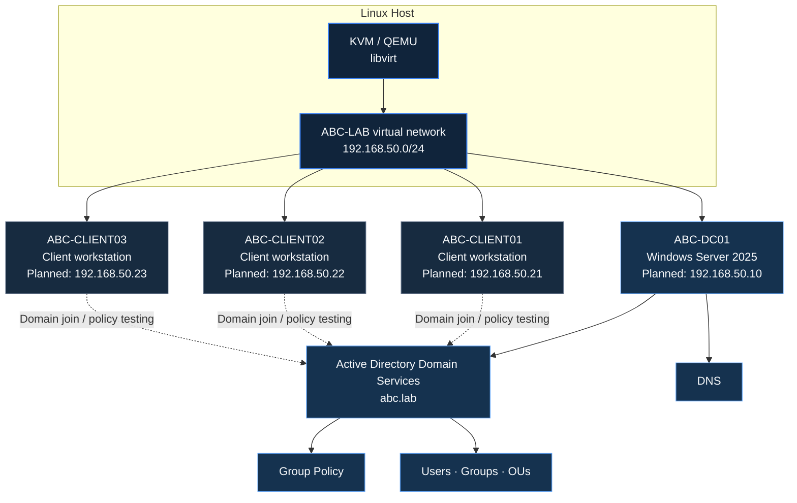

# ABC Corp — Windows Server 2025 Lab

### A hands-on enterprise IT environment for learning Windows Server, Active Directory, DNS, and Group Policy.

**Build it. Configure it. Test it. Document it.**

*A fictional company environment used to practise real-world Windows Server administration.*

---

## Overview

**ABC Corp** is a practical, self-managed lab for learning and documenting Windows Server administration. The lab uses a fictional company scenario to connect individual lessons into one coherent environment—from domain services and name resolution to organizational structure, user management, and security policy.

The goal is not just to follow configuration steps. It is to understand **what each component does, how the components depend on one another, and how to verify that the configuration works**.

> **Lab status:** This repository documents a learning environment. A topic listed as a learning objective is not necessarily configured or verified yet. Its status should be updated as the lab progresses.

## At a glance

| Item | Lab value |
|---|---|
| Project | ABC Corp — Windows Server 2025 Lab |
| Server operating system | Windows Server 2025 |
| AD DNS domain | `abc.lab` |
| NetBIOS domain name | `ABC` |
| Active Directory site | `ABC-HO` |
| Virtualization | KVM / QEMU with libvirt |
| Lab network | `ABC-LAB` — `192.168.50.0/24` |
| Lab gateway | `192.168.50.1` |
| Intended domain controller address | `192.168.50.10` |
| Intended client addresses | `192.168.50.21`–`192.168.50.23` |

**Addressing note:** The addresses above describe the lab plan, not proof that every guest is currently configured with those settings. Confirm the live guest configuration before relying on it. The physical LAN is separate from the isolated lab subnet.

## Architecture

The following diagram shows the intended logical design. It is a learning topology, not a live network discovery.

### How the pieces fit together

- **KVM/QEMU and libvirt** provide the virtual machines and virtual network.
- **ABC-DC01** is the intended Windows Server domain controller.
- **Active Directory Domain Services (AD DS)** stores and manages domain identities and directory objects.
- **DNS** enables clients to locate domain services and resolve names.
- **Organizational Units (OUs), users, and groups** provide a structure for administration and delegated management.
- **Group Policy** applies centrally managed configuration and security settings to eligible users and computers.
- **Client workstations** are used to test domain joining, sign-in, name resolution, and policy application.

## Learning roadmap

Use this roadmap to organize the lab. Mark an item complete only after performing and verifying it.

- [ ] **01 — Lab foundation:** virtual machines, virtual network, addressing, and basic connectivity
- [ ] **02 — Windows Server setup:** initial configuration, computer naming, network settings, and updates
- [ ] **03 — Active Directory:** AD DS installation, domain controller promotion, and domain health checks
- [ ] **04 — DNS:** forward lookup, reverse lookup, host records, and client name resolution
- [ ] **05 — Directory design:** OUs, users, groups, computer objects, and service-account concepts
- [ ] **06 — Client integration:** DNS configuration, domain join, domain sign-in, and troubleshooting
- [ ] **07 — Group Policy:** GPO links, inheritance, policy refresh, and resultant-policy verification
- [ ] **08 — Account security:** password policy, account lockout policy, and fine-grained password policies
- [ ] **09 — Administration and troubleshooting:** event logs, common AD/DNS failures, and documented recovery steps
- [ ] **10 — FSMO Roles in Active Directory:** Fundamental  understanding, verification, GUI veryfication
## Repository guide

Keep the repository easy to navigate as the lab grows. Replace the example paths below with the actual paths when the corresponding files are added.

| Path | Purpose |
|---|---|
| `README.md` | Project overview, architecture, roadmap, and navigation |
| `docs/` | Detailed lab guides and topic notes |
| `docs/architecture/` | Network and directory design |
| `docs/active-directory/` | AD DS, domain, OU, users, and groups |
| `docs/dns/` | DNS zones, records, and troubleshooting |
| `docs/group-policy/` | GPO configuration and policy testing |
| `screenshots/` | Supporting screenshots, with captions and relevant context |
| `troubleshooting/` | Symptoms, diagnosis, resolution, and verification notes |

*These paths are a suggested documentation structure; they should not be read as a claim that every folder already exists.*

## Lab documentation standard

For each exercise, record the following so that the result is reproducible:

1. **Objective** — what you are trying to configure or learn.
2. **Target system** — domain controller, member server, or client workstation.
3. **Prerequisites** — required roles, DNS settings, connectivity, permissions, and prior steps.
4. **Procedure** — exact GUI navigation and settings; include commands only when they add value.
5. **Verification** — the expected result and how it was confirmed.
6. **Evidence** — relevant screenshots or sanitized output.
7. **Troubleshooting** — symptoms, root cause, and resolution.
8. **Status** — Planned, In progress, Verified, or Needs review.

Never include real passwords, recovery keys, private keys, access tokens, or other secrets in screenshots or repository files. Sanitize hostnames, account details, and output where necessary before publishing.

## Design principles

- **One fictional company, one consistent environment:** use ABC Corp as the scenario throughout the lab.
- **Document verified state:** distinguish intended settings from settings that have actually been tested.
- **Explain dependencies:** for example, domain join depends on correct DNS and network connectivity.
- **Prefer repeatable steps:** record exact GUI paths, expected outcomes, and relevant screenshots.
- **Keep the lab safe:** use fictional identities and isolated test systems; do not expose lab services to the public internet unnecessarily.

## Scope and disclaimer

This is an educational lab, not a production deployment guide. Production environments require organization-specific security controls, backup and recovery planning, monitoring, access management, and change control. Configuration details may differ by Windows Server build and lab design.

---

**ABC CORP · WINDOWS SERVER 2025 LAB**

*Learn the infrastructure. Understand the dependencies. Verify the result.*

